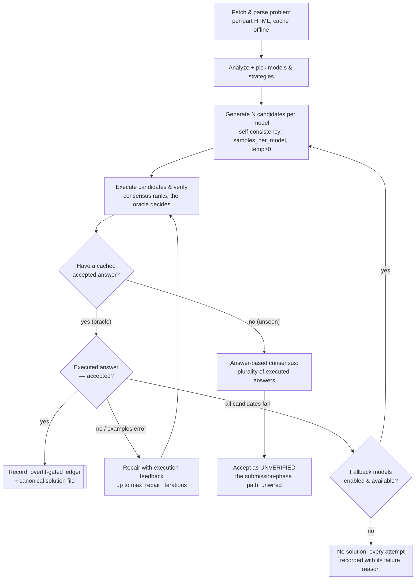

#  Problem Solver

**A research platform for measuring whether coordinating several LLM attempts beats a single one —
and by how much.** Local models (via Ollama) propose solutions to Advent of Code problems; a
correctness oracle executes each candidate against the real puzzle input and compares it to the
accepted answer. Because the check is cheap and exact, every orchestration idea can be A/B'd for a
real delta over repeat trials, so results are evidence rather than anecdote.

The project grew out of competing in the 2024 and 2025 Advent of Code events myself: solving the
puzzles by hand led me to ask whether local models could be coordinated to solve them systematically —
and, more to the point, whether that could be *measured* rather than asserted.

> ### The quick version
>
> - **What it is** — local LLMs propose Python solutions to Advent of Code puzzles; an automatic
>   judge (an *oracle*) runs each one against the real input and checks it against the known-correct
>   answer, so every claim about orchestration is an A/B over repeat trials.
> - **The biggest effect was the harness, not the strategy.** Part 2 prompts were missing the Part 1
>   statement, so drafts had to guess the rules and input format. In the controlled test, 2024 d19
>   p2 with only the context changed, single drafts went from 6 of 20 to 19 of 19. On 13 other
>   Part 2s the reference model had failed, they went from 2 of 53 trials solved to 29 of 37 (those
>   problems were chosen because they had failed, and two smaller settings changed alongside): an
>   apparent capability cliff was mostly missing information. *Caveat:* the puzzles are public,
>   and the added Part 1 text is also their published wording, which may cue recall; a test that
>   separates the two is planned.
> - **Sampling can only help where a single draft succeeds part of the time**, because draws
>   behave as independent. It took the model's "sometimes" problems from **42% to 75%** under the original
>   harness, replicated on a second year. Under the corrected harness few problems sit in that
>   band, and on the one that does, 2025 d9 p2, the lift was not re-established: a registered
>   replication gave 13/35 at one draft and 16/35 at three (one-sided p = 0.31; 95% interval for
>   the difference −14 to +30 points). The draws were independent again; at its 20% per-draft rate
>   three drafts were expected to add about 12 points over one draft with repair, a gap this test
>   could not separate from zero.
> - **A second model helped by being chosen, not mixed.** One model solved a problem 10 of 10 times
>   that the reference solved 1 of 10, and no problem was found where the reference's lead held, so
>   a mix had nothing to add on the problems measured and was not run. Cheap draws won on time and
>   lost on tokens (one trial, 8 problem-parts).
> - **The caveat** — the puzzles are public and pre-date the models, so a model may have trained on
>   solutions. That softens the *"how capable is the model?"* numbers and any comparison that
>   changes the prompt or the model, not comparisons of one strategy against another with the same
>   model, prompt and problems. Every result here is one model family on one benchmark; the limits
>   are listed in [RESULTS.md](RESULTS.md#scope-and-limits).
> - **Where to go next** — [RESULTS.md](RESULTS.md) for the full science · [How it works](#how-it-works)
>   for the pipeline · [Getting started](#getting-started) to run it yourself.

<details>
<summary><strong>Key terms</strong></summary>

- **Oracle** — the automatic judge. It runs the model's code against the real puzzle input and
  compares the output to the known-correct answer. Cheap and exact, which is what makes everything
  else measurable.
- **The model's *frontier*** — the problems it solves *sometimes but not always*. Easy ones it always
  gets; impossible ones it never does; the frontier is the uncertain band in between — where
  coordinating attempts can actually help.
- **pass@1 vs pass@k** — pass@1 is "did *one* attempt solve it?"; pass@k is "did *any* of k attempts
  solve it?" The gap between them is the room sampling has to work in.
- **Sampling** — draw several candidate solutions instead of one and keep one the oracle accepts.
  Here the oracle selects; textbook self-consistency picks by majority vote without a verifier. It
  can turn "sometimes" into "solved" on problems the model can already sometimes solve.
- **Self-repair** — show the model its own execution error (the traceback, the example's result,
  whether the answer was too high or too low) and let it try again. It adds information, but the
  reference model's repairs rarely succeeded (13 of 368 attempts).
- **Solved** — a trial counts as solved when any of its drafts or repairs produces the accepted
  answer. The oracle does the choosing, so multi-draft rates are what a perfect verifier would
  get: on 2025 d9 p2, choosing by the worked example alone solved 12 of 35 three-draft trials and
  took a wrong answer in 15, where the oracle solved 14 from the same drafts.
- **Contamination** — the puzzles are public and predate the models, so a model may have trained on
  solutions to them. It muddies *"how capable is the model"*, and any comparison that changes the
  prompt or the model, but not a comparison of strategies with the same model, prompt and problems.

</details>

## What it is

**The larger objective is generalized problem-solving through LLM orchestration** — extracting more
correctness from models by *how* they're combined (sampling, consensus, verification, repair, diverse
ensembles) than any single model yields alone. Advent of Code is the current testbed, not the point:
it supplies a stream of self-contained problems with a cheap correctness check, which is exactly what
makes the orchestration question measurable.

Structurally the machine is a **proposer–verifier loop**: local models *propose* solutions — they're
prediction machines, cheap and fallible and high-variance — and a cheap, exact **verifier** (run the
code, compare to the accepted answer) *disposes*. Truth enters through the parts that don't predict,
and that asymmetry is why coordinating predictors pays off at all: sampling, voting, and repair
convert into correctness only because a cheap check can collapse many guesses to one verified answer.
Where no such check exists, the coordination has little to grip — which is also where this approach
stops being a good fit.

That objective is pursued through two pieces, in order of importance:

1. **A measurement platform.** A frozen, fingerprinted `SolverConfig`; an experiment harness
   (`experiment.py`, `shared/experiment/`) that runs a problem set under one or more configs with
   `--trials N`; a correctness **oracle** (`shared/verification.py`, `shared/ground_truth.py`) that
   judges every candidate against the cached accepted AoC answer, with an overfit gate
   (`shared/overfit_detection.py`); and independent verification so *claimed* and *verified* are
   never conflated. This is what lets an orchestration idea be A/B'd for a real delta.

2. **An AoC solver.** `BaseSolver.solve_problem` (`shared/solver.py`) is a short orchestrator over
   four stages — prepare → generate → consensus → execute/repair/fallback — driving local models to
   solve a puzzle and recording verified solutions to a ledger (`solutions/README.md`).

## What we learned

Seven findings, most instructive first. Every figure links to a committed write-up in
[`dev/progress/`](dev/progress/); the full statistics live in [RESULTS.md](RESULTS.md).

**1. The biggest effect was the harness: a missing Part 1 statement looked like a capability cliff.**

An Advent of Code Part Two amends Part One and rarely restates the setup. The harness posed each
Part 2 with the "Part Two" article alone: no rules, no input format, no worked example. On 2024
d19 p2 that decided everything: of 80 first drafts, the correct ones were exactly the drafts that
guessed the input format, and none of the 54 that guessed wrong was correct. With the Part 1
statement, answer and program in the prompt:

| | before | after |
|---|---|---|
| 2024 d19 p2, one draft, only the context changed | 6/20 | **19/19** |
| 13 other Part 2s the reference had failed, one draft | 2/53 | **29/37** |
| 2025 d9 p2, one or three drafts | 0/22 (three models) | **31/58** at three drafts (three runs) |

The 13-problem row compares single-draft trials only; its "before" trials ran on two machines
over two months, and its "after" changed two smaller settings alongside the context. The d19 row
is the controlled test. The puzzles are public, so the added Part 1 text is information and also
possibly a memory cue ([contamination](RESULTS.md#training-data-contamination-the-largest-threat-to-validity));
`dev/progress/part2-context-heldout-plan.md` designs the test that separates them.

The "Part 1/Part 2 cliff" seen in two years of scans, and the "walls" that had become the project's
most reproducible results, were mostly this defect. One Part 2, 2024 d24 p2, is still unsolved by
every model tried. (`part2-prompt-omits-part1.md`, `m5pro-rescan-part2-aoc.md`)

**2. Sampling: a gain under the original harness, not re-established under the corrected one. The draws behave as independent throughout.**

**Now:** under the corrected harness most problems are solved by nearly every draft or by nearly
none, where three drafts gave no measurable lift (9/19 against 11/21). On the one problem in
between, 2025 d9 p2, a registered replication with every trial reaching Part 2, 35 trials per arm,
gave 13/35 at one draft and 16/35 at three: one-sided p = 0.31, 95% Newcombe interval for the
difference −14 to +30 points, **not re-established** on this problem. The draws were independent
(20% per draft predicts 49% at three; 46% measured), but the draft rate was lower than the 27%
assumed, and repair lifted one draft from 26% to 37%, so three drafts were expected to add about
12 points, and added 9: a gap that 35 trials per arm cannot separate from zero. An earlier
registered test on the same problem, 20 trials per arm, had given 5/15 at one draft and 13/20 at
three (trials that reached Part 2; one-sided p = 0.065, inconclusive).

**Under the original harness**, on the problems the strongest model solved only *sometimes* (its
frontier, identified beforehand):

| approach | solve rate |
|---|---|
| 1 attempt, with self-repair from execution feedback | **42%** |
| 3 independent attempts, no feedback | **58%** |
| **3 attempts, each with execution feedback** | **75%** |

Repeated out of sample on **AoC 2025**, it rescued exactly the uncertain problems (2 of 8 → 6 of 6)
and nothing else; combined one-sided p ≈ 0.005. A 20-trial test showed why: first drafts were right
20% of the time, which predicts 49% at three drafts, and 50% was measured. Those Part 2s were posed
without Part 1, so these rates describe the old harness. (`passk-ab-d13-d15.md`,
`passk-replication-2025.md`, `m5pro-d19p2-power.md`, `m5pro-band-k1-vs-k3-aoc.md`,
`m5pro-d9p2-power-aoc.md`, `m5pro-d9p2-replication.md`)

<details>
<summary>The statistics</summary>

Original harness: the 2024 result **alone is marginal**, one-sided Fisher exact p ≈ 0.06 on the
aggregate. The **out-of-sample replication** supports it (2025: 2/8 → 6/6, one-sided p ≈ 0.009 on
14 trials; combined by Fisher's method, p ≈ 0.005). Caveats: n = 3 trials per problem, k = 5 not run, one model, one
temperature, four problems in the band, and the corner with one draft and no repair was
not run, so sampling's and repair's shares cannot be separated.

</details>

**3. A second model helped by being chosen, not mixed.**

A mix of models can only add what its members solve *differently*. Six candidates were measured
alone against the reference, `qwen3.8:27b`, with every lead re-tested at ten trials. One held:
`muse-glimmer:30b` solved 2024 d14 p2 **10 of 10** times against the reference's **1 of 10**, and gave
the first verified 2024 d21. A search for problems the reference solves better found none where its
lead held at ten trials, so a mix had nothing to add on the problems measured and was not run:
choosing muse gives the gain. Three of the four leads found at three
trials did not survive ten. (`arm3-precheck-muse-glimmer-30b.md`, `arm3-portfolio-test.md`)

**4. Repair depends on the model, and what still fails is mostly speed.**

Shown its own failure with true example results and a too-high/too-low hint, the reference fixed
almost nothing: its repairs succeeded 13 times in 368 attempts, muse's 14 in 80 (on the problems
both repaired, 12 in 358 against 8 in 67). On the hardest
problems the commonest failure is a program that runs past the 60 s timeout on the full input (27 of
51 failed attempts on two of them), often after passing the example. More time did not rescue them
on 2025 d9 p2: none of 45 timed-out drafts finished correctly within 600 s under an 8 GB memory
cap (26 hit the cap, 17 were still running). Larger models did not move those problems.
(`m5pro-band-k1-vs-k3-aoc.md`, `arm3-portfolio-test.md`, `m5pro-d9p2-replication.md`)

**5. Cheap draws beat one expensive pass — on time, not on tokens.**

At a matched wall-clock budget, a fast weak model taking many draws vs a slow strong model taking
few, one trial on 8 problem-parts (2024 d4–7):

| | solved | **s / verified solution** | **tokens / verified solution** |
|---|---|---|---|
| `qwen3.8:27b` k=3 (slow, strong) | **8/8** | 1,389 s | **38,460** |
| `qwen3-coder:30b` k=12 (fast, weak) | 7/8 | **891 s** (0.64×) | ≥119,068 (≥3.09×) |

For local GPU inference, where cost is *time*, many cheap draws win by 36% per verified solution.
For a token-metered API they lose by at least 3.09×. The weak model also solved one problem-part
fewer (7/8 against 8/8), a single-trial observation. (`economic-arm-moe-vs-generalist.md`)

**6. The newest, smallest model scored highest.**

Three models of similar size on the same 8 problem-parts (2024 d4–7, one trial each), each
**smaller** than the last:

| model | size | class | solved |
|---|---|---|---|
| `qwen2.5-coder:32b` (late 2024) | 19 GB | code specialist | 4/8 |
| `qwen3-coder:30b` (newer, MoE) | 18 GB | code specialist | 6/8 |
| **`qwen3.8:27b` (2026)** | **17 GB** | **generalist** | **8/8** |

The 2024 specialist scored *below* what 12B models had achieved on half the RAM. Generation,
specialisation and architecture change together across the three, and each was run once, so this
describes these models rather than isolating a cause. ⚠️ A newer model is
both plausibly stronger *and* more likely to have trained on these public puzzles; this work does not
separate the two ([contamination](RESULTS.md#training-data-contamination-the-largest-threat-to-validity)).
(`m2max-qwen38-27b-d4-7.md` and siblings)

**7. Measurement is most of the work.**

Twelve instrument defects were found and fixed, each with regression tests: a crash recorded as
"the model failed" for eight months, an anti-overfit gate *rejecting correct solutions*, invented
rows in the results database, token counts copied onto repair records, and the Part 2 prompt above.
A running tally kept in prose silently dropped the runs where a problem *did* solve; the rule since is
that every figure is recomputed from the run artifacts. (Full list in
[RESULTS.md](RESULTS.md#what-the-measurements-cost-in-credibility-and-why-that-matters).)

## How the thinking changed

**Noise first.** On a 16 GB machine the pipeline turned out non-deterministic: byte-identical configs
flipped 4 of 6 problems between solved and unsolved. Single runs were noise, so every comparison
became a repeat-trial A/B, and drawing several samples per model became the first measured win
(39% → 61%).

**Then capability.** The hard problems stayed unsolved by every model that fit 16 GB. On 32 GB a
newer 27B generalist swept them, and the question moved from "can it solve these?" to the thesis:
does coordinating attempts keep its value as models strengthen? Three arms were argued — sampling,
economics, portfolios — and the first two were measured: sampling 42% → 75% with an out-of-sample
replication, and an economic split between time and tokens.

**Five nulls and a rule.** Raising the temperature, rewording the repair feedback and three
mechanistic predictions all failed on the next run. Read together they gave the filter: *an
intervention that adds no new information does not help*. A handful of problems resisted everything
and were treated as walls that sampling cannot touch.

**The walls were the harness.** A 20-trial power test on 2024 d19 p2, meant to firm up arm 1, left
80 saved drafts; their pattern showed the model was solving Part 2 without being told Part 1. The
fix — give the model what a human solver on the site sees — dissolved most walls and the cliff
between the parts. It was the information rule at its largest: the biggest gain came from
information the model had been denied.

**Re-earning the claims.** Every Part 2 the reference had failed was re-run under the corrected
harness, and sampling was re-tested on the problems still in between. The draft rates turned out
mostly all-or-nothing. On the one mid-rate problem a powered test came out inconclusive
(p = 0.065) and its registered replication did not re-establish the lift (p = 0.31), so under the
corrected harness sampling's measured gain rests on the original harness's results; the
independence of the draws held throughout. The portfolio arm, untested for want of a model pair, got its pair on a 64 GB machine,
with an entry criterion, a selection-bias guard and ten-trial deciders; the complementarity ran one
way.

**What is open:** AoC 2026 in December, the first problems the models cannot have seen
([Status](#status)), and with it whether the Part 1 context informs or cues recall.

## How it works

A model's *text* is never trusted; only code that **executes to the accepted answer** is recorded.
Self-consistency fans out several candidates; the oracle decides; a repair loop and fallback models
get extra shots before giving up.



Every arrow that ends in a record is **oracle-gated** — a wrong or overfit candidate is refused, not
logged as solved. Every attempt (solved or not) is recorded with its outcome and failure reason, so
runs are diagnosable after the fact.

<details>
<summary><strong>How each part of the thesis was tested</strong></summary>

*The audit trail behind the findings, in the order it happened, including milestones later
superseded. [RESULTS.md](RESULTS.md) organizes the same findings by thesis arm.*

### Early milestones

Every one of these is a committed A/B or analysis in `dev/progress/`, not an assertion:

- **Single runs are noise.** The pipeline is non-deterministic; across byte-identical configs,
  4 of 6 baseline problems flipped between solved and unsolved. Reporting needs repeat trials.
- **Self-consistency is a real win.** Drawing several samples per model (`samples_per_model`) at
  `temperature>0` lifted the solve rate **39% → 61%** on 2024 d1–3 and took **0 → 3 of 6** problems
  to *solved every trial*, with the oracle choosing among the drafts. It reduces run-to-run
  variance on problems the model can already sometimes solve. (`dev/progress/milestone-e-self-consistency.md`)
- **Answer-based consensus is a good no-oracle selector.** On the sample data, plurality vote over
  the *executed* answer would have picked the correct answer 10/11 times — the selector the
  submission phase needs. (`dev/progress/milestone-e-answer-consensus.md`)
- **Model capability dominates on the hard problems — and it was mis-assumed.** On the never-scored
  2024 d4–7, `qwen2.5-coder:7b` (the original baseline) solves only **1 of 8**. But two newer models
  that *also fit 16 GB* — `qwen3.5:9b` and `gemma4:12b` — reach **5 of 8** and crack Part 2s the 7B
  never touches. Self-consistency fixes *variance*; a better model is what adds *capability*.
  (`dev/progress/scale-2024-d4-7.md`, `9b-confirmation-d4-7.md`, `model-bakeoff-gemma4-vs-9b.md`)
- **Reasoning models need a leash.** A reasoning model (`qwen3.5:9b`) left to think freely emits
  tens of thousands of chars of chain-of-thought and never reaches the code; an `enable_thinking=false`
  toggle turns it into a fast, direct coder. Capability is only useful if the harness can extract it.
- **The 16 GB ceiling: two different walls, and the first diagnosis conflated them.**
  The hardest Part 2s (2024 d5 p2, d6 p2) stayed unsolved for every 16 GB model, and a 5×
  execution-timeout recovered nothing, so this read as "the model finds the right idea but writes
  code too slow" (`dev/progress/9b-timeout-investigation.md`). The M2 Max runs split that in two:
  **d5 p2 was never speed-bound** — a newer model solved it with a **Kahn's-algorithm topological
  sort**, an approach the earlier models never proposed — while **d6 p2 genuinely was**, falling to
  a plain brute force that finally ran inside the timeout on faster hardware. One algorithm wall,
  one speed wall, described for months as a single phenomenon. Both are now solved and in the
  ledger. (`dev/progress/m2max-qwen38-27b-d4-7.md`, `m2max-qwen3coder30b-d4-7.md`)

The headline: **on this fixed problem set, the binding constraint was model capability, not
orchestration** — and on 32 GB that constraint dissolved once a *newer-generation* model was
available: `qwen3.8:27b` solved **all 8**, while a bigger *older* model did worse than
16 GB managed. The set is now exhausted as a capability measure. Full numbers:
`dev/benchmarks/cross-machine-results.md`. But that describes *a fixed band of problems*, not
orchestration in general — which raises the project's central open question.

### Does orchestrated voting scale? (sampling: yes under the original harness, not re-established under the corrected one; economics: on time, not tokens; portfolios: choose, don't mix)

Frontier models are trained to be the best solver *on their own*, and hardware keeps growing — so why
orchestrate several votes at all? This is the question that carries the work beyond AoC, so it gets
an answer separate from the solve rates, marking what is argued and what is measured.

**Why voting should keep its value as models strengthen:**

1. **The pass@k-vs-pass@1 gap never closes at a model's own frontier.** Every model samples from a
   distribution; on the hardest problems it can *sometimes* solve, the modal answer isn't reliably
   correct but the right one appears among several draws. Sampling N and selecting by consensus or a
   verifier turns "sometimes" into "solved". A stronger model needs fewer draws, but the gap reappears
   at *its* harder frontier — the value moves up with the model rather than vanishing.
2. **A cheap verifier turns k draws into one answer — an economic scaling law.** Where correctness is
   checkable (the oracle here, unit tests, a compiler, a proof checker), many cheap draws plus selection
   can beat one expensive "think-harder" pass at equal or lower cost — a trade that only improves as
   per-draw cost falls.
3. **Diverse portfolios decorrelate error.** Even a frontier model has systematic blind spots; an
   ensemble of *different* models wins where their mistakes are uncorrelated.

**Arm 1 — sampling.** The main test under the original harness ran on `qwen3.8:27b` at its *own* measured frontier:
**pass@1 42% → pass@3 75%** (`dev/progress/passk-ab-d13-d15.md`). The band was selected
beforehand by an independent 3-trial classification, and the theoretical curve was registered in
writing before the k3 arm ran. The comparison is *1 sample vs 3 samples with the repair loop held
at 2 iterations in both arms*, so this is "k samples + repair", not textbook pass@k over
independent draws. A problem twice called an "insight wall" was solved 3 of 3, so under the
original harness **sampling reached insight problems, not only fiddly ones** (under the corrected
harness that problem is solved 3 of 3 at one draft); one predicted at 70% scored 0 of 3, and its full
record puts it near 12% per draw (`dev/progress/CORRECTION-d15p2-is-not-a-wall.md`). Under the
corrected harness the draft rates are mostly near 0% or 100%, three drafts gave no measurable lift,
and on 2025 d9 p2, the one mid-rate problem, the lift was not re-established (finding 2).

**Arm 2 — economics, and it splits.** *Many cheap draws beat one expensive pass* is **true on
wall-clock** (0.64× per verified solution) and **false on tokens** (at least 3.09×), and volume does not reach
the stronger model's ceiling (7/8 vs 8/8). The useful form of the claim: *cheap draws win when the
binding cost is time, not tokens, and only up to the cheap model's ceiling.*
(`economic-arm-moe-vs-generalist.md`)

**Arm 3 — portfolios: the better model, not the mix.** Of six candidates, one, `muse-glimmer:30b`,
reliably solved a cell the reference reliably misses: 2024 d14 p2, 10/10 against 1/10. A portfolio
test then looked for cells where the reference beats muse, which a mix needs to beat both models at
equal draws; none held, so the ensemble was not run. On these cells choosing muse gives the gain a
mix could (`arm3-precheck-muse-glimmer-30b.md`, `arm3-portfolio-test.md`).

Practical recommendations: [RESULTS.md](RESULTS.md#practical-recommendations).

</details>

## Running an experiment

The platform's primary entry point is `experiment.py`:

```bash
# One config over 2024 days 1-3, 5 trials (the pipeline is non-deterministic)
venv/bin/python experiment.py --problems 2024:1-3 --trials 5 \
    --config "name=baseline,models=qwen2.5-coder:7b"

# A/B two configs and print a comparison (self-consistency isolated)
venv/bin/python experiment.py --problems 2024:1-3 --trials 3 \
    --config "name=samp1,models=qwen2.5-coder:7b,temperature=0.7,samples_per_model=1" \
    --config "name=samp3,models=qwen2.5-coder:7b,temperature=0.7,samples_per_model=3"

# Score already-recorded solutions without calling a model
venv/bin/python experiment.py --problems 2024:1-6 --dry-run
```

`--config` takes `key=value` overrides of `SolverConfig`; every field that enters the config
fingerprint changes what a run does, so two configs with different fingerprints are genuinely
different experiments. Verify the recorded solutions at any time with `dev/verify_solutions.py`.

**Solving a single problem:**

```bash
venv/bin/python solve.py --year 2024 --day 1 --part 1   # --force to re-solve, --debug for logs
```

## Getting started

1. One-shot setup (venv + deps + `.env` scaffold + a RAM-matched model tier):
   ```bash
   ./scripts/setup.sh
   ```
   Or by hand — always into the project venv, never a bare `pip` (see `AGENTS.md`):
   ```bash
   python3.11 -m venv venv
   venv/bin/python -m pip install -r requirements.lock
   ```
   `requirements.lock` pins the exact versions the results were measured with (Python 3.11).
   On another Python, install `-r requirements.txt -r requirements-dev.txt` instead; the
   packages that parse puzzles and score candidates will then be newer than those measured.
2. Install [Ollama](https://ollama.ai) and pull at least one coding model (the solver checks which
   configured models are actually installed and errors clearly if none are):
   ```bash
   ollama pull qwen2.5-coder:7b
   ```
3. `AOC_SESSION`: needed to **fetch** problems, inputs, and the accepted answers the oracle scores
   against. `years/` is gitignored — a fresh clone has no cached data, so the oracle cannot run
   until you either fetch with a session cookie (see below; put it in `.env`, gitignored) or copy
   `years/` from a machine that has it. Once cached, everything runs offline. The accepted answers
   only exist for days *your account* has solved — that's what makes them ground truth.
4. Run tests: `PYTHONPATH=. venv/bin/pytest -q` (green without cached data too — the data-dependent
   tests skip themselves, reported as skips).

<details>
<summary>Getting the AoC session cookie (Safari)</summary>

Enable the Develop menu (Settings → Advanced → "Show features for web developers"), log in to
adventofcode.com, open Web Inspector (⌥⌘I) → Storage → Cookies → adventofcode.com, and copy the
**`session`** value. It is a secret — keep it in `.env`, never commit it.

</details>

## Data, privacy, and Advent of Code's rules

AoC asks that **puzzle text and puzzle inputs not be redistributed**, and inputs are per-account
anyway. This repo is built so that constraint is structural rather than a matter of remembering:

- **Never committed** (all of `years/` is gitignored): puzzle HTML, puzzle inputs, and the scraped
  accepted answers the oracle reads. A fresh clone therefore has *no* AoC data and cannot run the
  oracle until you supply your own session cookie. (This is why `dev/verify_solutions.py` reports
  "missing input file" on a clean checkout — working as intended.)
- **Also never committed:** the session cookie and contact string. Both live in `.env`, which is
  gitignored; `.env.example` ships placeholders only.
- **Committed by design:** the solver's own generated Python solutions (`solutions/`), the verified
  ledger (`solutions/README.md`), and the experiment write-ups in `dev/progress/`. A few of those
  quote **short fragments of the public worked *examples*** (never real inputs) where a specific
  parsing failure has to be shown to be understood.
- **Raw run artifacts** (`dev/experiments/*.json`) are gitignored too — they embed accepted
  answers, generated source and execution output. Their outcomes, timings and token counts, with
  none of that, are committed as tables in `dev/results/`, and `dev/recompute_results.py`
  recomputes the published figures from them (CI checks that the docs match).

<details>
<summary>Why this is compliant with AoC's guidelines</summary>

AoC's [about page](https://adventofcode.com/about) asks (verbatim):

> *"Please don't. Advent of Code is free to use, not free to copy. If you're posting a code
> repository somewhere, please don't include parts of Advent of Code like the puzzle text or your
> inputs."*

and separately permits:

> *"You may link to or reference puzzles from Advent of Code in discussions, classes, source code,
> printed material, etc."* … *"Advent of Code does not claim ownership or copyright over your
> solution implementation."*

Mapping that onto what this repo contains:

| what | where | why it's fine |
|---|---|---|
| puzzle text, inputs, scraped answers | **not committed** (`years/`, gitignored) | exactly what the guideline says to exclude |
| generated solution code | `solutions/` | explicitly ours; AoC disclaims ownership of solutions |
| accepted answers | `solutions/README.md` | not covered by the request, and **per-account** — these answers cannot help anyone else, since a different account gets a different input and a different answer |
| short worked-*example* fragments (e.g. one input line) | a few findings + regression fixtures | *referencing* a puzzle to explain a specific parser failure, which the guideline permits; no puzzle is reproduced and nothing is spoiled |

The example fragments are deliberately minimal and load-bearing: the overfit-gate regression tests
cannot assert on example-literal reuse without an example literal, and a finding that says "the model
crashed parsing this line" is unverifiable without the line.

One timing note for anyone reusing this: publishing *current-year* solutions during the December event
cuts against community norms even where it is permitted. Everything measured here is from past years.

</details>

## What it's suited to (and what it isn't)

The testbed is AoC, but the *shape* of problem the pipeline handles well generalizes. It works best
where a candidate can be **checked automatically and cheaply**:

- **Well-suited:** self-contained algorithmic problems with a deterministic answer and a fast check —
  parsing, simulation, small graph/grid work, arithmetic-heavy puzzles. The oracle (or example cases)
  gives an unambiguous pass/fail, so self-consistency and the repair loop have a signal to climb.
- **Less-suited:** problems whose answer is subjective or expensive to verify (no oracle → the whole
  measured-not-asserted premise weakens), and problems where the *idea* is easy but the naive
  implementation is too slow for the real input — the hard AoC Part 2s. There the limit is algorithm
  efficiency, which orchestration can't manufacture.

**What carries over, and what doesn't.** Measured here, untested elsewhere:

- *Likely to carry over:* whether sampling pays depends on how often a single draft succeeds; on
  the problem tested, drafts failed independently, so the gain was predictable from the first-draft
  rate; a second model added its gain by being chosen, not mixed; many cheap draws saved time but
  cost more tokens; repair rarely rescued the reference's wrong drafts.
- *AoC-specific:* the solve rates, which models solve which days, and the Part 2 harness defect
  (though the lesson, that a prompt missing context looks like a capability limit, is general).
- *Unmeasured:* every result above used an exact checker. How they hold when the only check is
  partial, as with unit tests, is the next question (`PLAN.md`, "Beyond AoC").

**The harness turns model capability into verified solutions wherever there's a cheap
checker; it can't invent capability the model lacks, nor a faster algorithm than the model writes.**

## How the code is organized

```
experiment.py            Experiment harness entry point (--trials, --config, A/B)
solve.py                 Single-problem entry point
shared/
  experiment/            The platform: SolverConfig, results, runner
  verification.py        Correctness oracle (candidate vs accepted answer)
  sandbox.py             What generated code may see: no .env secrets, resource limits
  ground_truth.py        Cached accepted answers
  overfit_detection.py   Overfit gate before a solution is recorded
  solver.py              BaseSolver.solve_problem orchestrator + stages
  aoc.py                 AoC I/O: session, HTTP, problem fetch + cache
  paths.py               Path primitives (leaf module, no cycles)
  ledger.py              Oracle-gated solution recording
  llm/                   Ollama provider (local.py) + prompts.py
  strategy_recommender.py, strategies.py   Strategy seeding
learning/                One SQLite DB: model + strategy performance
submission/              Real AoC submitter -- isolated and UNWIRED (reserved for the solver phase)
solutions/               Verified solutions + the ledger (README.md)
dev/progress/            The measured findings (baselines, A/Bs, the capability frontier)
dev/results/             Run outcomes as tables; recompute_results.py checks the docs against them
dev/benchmarks/          Cross-machine results, keyed by hardware (solve rate by model/config)
years/                   Cached problem data (gitignored)
```

`PLAN.md` (repo root) is the forward roadmap; `dev/progress/checkpoint.md` is the live status
snapshot and `dev/docs/architecture.md` the design overview.

## Status

**Working and measured:** the full solve pipeline (fetch → parse → generate → consensus →
execute/verify → repair → fallback), the experiment harness with repeat trials and fingerprinted
configs, the correctness oracle and overfit gate, self-consistency and answer-based consensus, and
**69 verified solutions** across two AoC years (`dev/verify_solutions.py` clean).

**Each thesis arm has a verdict** ([What we learned](#what-we-learned)): sampling measured and
replicated under the original harness, not re-established under the corrected one (on its one
mid-rate problem, an inconclusive test and then a registered replication, p = 0.31); economics
splits by whether time or tokens is the binding cost; portfolios: the one complementary pair was
one-way, so the ensemble was not run. Open, in priority order (`PLAN.md`, "Open"):
1. **AoC 2026, the clean contamination test.** The first problems published after the models'
   training cutoff. *Waits on a maintainer decision* by about 2026-11-25: submit answers
   automatically or by hand, and at what rate; then the submitter is wired in (without it an
   unseen year cannot reach Part 2), and the models, prompts and configuration are frozen before
   2026-12-01.
2. **Does the Part 1 context inform, or cue recall?** The headline's caveat, tested on AoC 2026,
   where nothing can be recalled: Part 2 with and without the Part 1 context
   (`dev/progress/part2-context-heldout-plan.md`). *Waits on* item 1.

Beyond those (`PLAN.md`, "Beyond AoC"): how far the results depend on an exact checker. Every
attempt records the worked examples' verdict beside the oracle's from 2026-11-09; first data, 2025
d9 p2: the example passed most of the Part 2 attempts the oracle rejected, and a selector using it
alone took a wrong draft in 15 of 35 trials (`m5pro-d9p2-replication.md`). Then a second domain.
Not scheduled: what decorrelates draws. Temperature and reworded feedback moved nothing, and
mixing models was one-way on the problems measured; prompt variants remain untested.

<details>
<summary>Reproducing older runs, and the deliberately unwired submitter</summary>

Runs recorded before 2026-10-13 posed Part 2 without the Part 1 statement and reproduce with
`problem_context=legacy,analysis_temperature=model_default,example_tests=parser`
(`dev/progress/part2-prompt-omits-part1.md`); runs of 2026-10-13 itself need only
`example_tests=parser` (`dev/progress/example-tests-mispaired.md`).

**Deliberately unwired:** the AoC answer submitter (`submission/`) is real and tested, and
kept out of the solve loop by design — the evaluation set is *past* AoC years, already solved on the
maintainer's account, so there is no unseen answer to submit. Wiring it is the live-contest path.

</details>

## Credits & license

Developed by **Martin Diekhoff**. MIT License — see [LICENSE](LICENSE).
