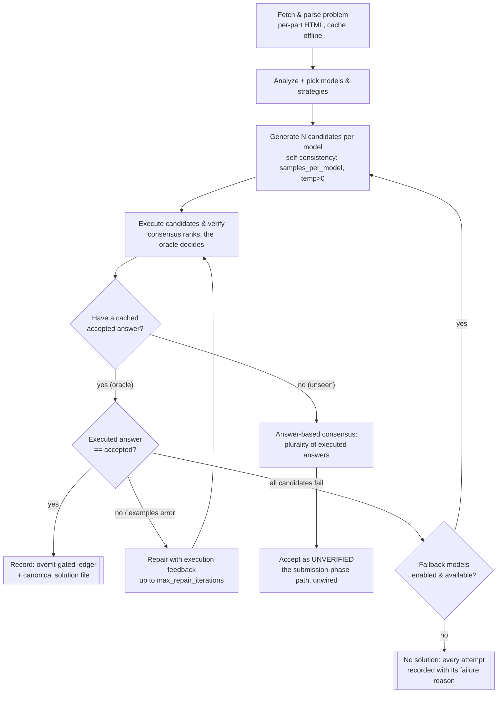

#  Problem Solver

**A research platform for measuring whether coordinating several LLM attempts beats a single one —
and by how much.** Local models (via Ollama) propose solutions to Advent of Code problems; a
correctness oracle executes each candidate against the real puzzle input and compares it to the
accepted answer. Because the check is cheap and exact, every orchestration idea can be A/B'd for a
real delta over repeat trials, so results are evidence rather than anecdote.

The project grew out of competing in the 2024 and 2025 Advent of Code events myself: solving the
puzzles by hand led me to ask whether local models could be coordinated to solve them systematically —
and, more to the point, whether that could be *measured* rather than asserted.

> ### The quick version
>
> - **What it is** — local LLMs propose Python solutions to Advent of Code puzzles; an automatic
>   judge (an *oracle*) runs each one against the real input and checks it against the known-correct
>   answer, so every claim about orchestration is an A/B over repeat trials.
> - **The biggest effect was the harness, not the strategy.** Part 2 prompts were missing the Part 1
>   statement, so drafts had to guess the rules and input format. In the controlled test, 2024 d19
>   p2 with only the context changed, single drafts went from 6 of 20 to 19 of 19. On 13 other
>   Part 2s the reference model had failed, they went from 2 of 53 trials solved to 29 of 37 (those
>   problems were chosen because they had failed, and two smaller settings changed alongside): an
>   apparent capability cliff was mostly missing information. *Caveat:* the puzzles are public,
>   and the added Part 1 text is also their published wording, which may cue recall; a test that
>   separates the two is planned.
> - **Sampling can only help where a single draft succeeds part of the time**, because draws
>   behave as independent. It took the model's "sometimes" problems from **42% to 75%** under the
>   original harness, replicated on a second year. Under the corrected harness few problems sit in that
>   band, and on the one that does, 2025 d9 p2, the lift was not re-established: a registered
>   replication gave 13/35 at one draft and 16/35 at three (one-sided p = 0.31; 95% interval for
>   the difference −14 to +30 points). The draws were independent again; at its 20% per-draft rate
>   three drafts were expected to add about 12 points over one draft with repair, a gap this test
>   could not separate from zero.
> - **A second model helped by being chosen, not mixed.** One model solved a problem 10 of 10 times
>   that the reference solved 1 of 10, and no problem was found where the reference's lead held, so
>   a mix had nothing to add on the problems measured and was not run. Cheap draws won on time and
>   lost on tokens (one trial, 8 problem-parts).
> - **The caveat** — the puzzles are public and pre-date the models, so a model may have trained on
>   solutions. That softens the *"how capable is the model?"* numbers and any comparison that
>   changes the prompt or the model. Comparisons of one strategy against another with the same
>   model, prompt and problems are less exposed, but their effect sizes may not carry over to
>   unseen problems; AoC 2026 is the test. "Solved" means correct on this account's puzzle input.
>   The main results rest on one reference model and one benchmark; the limits are listed in
>   [RESULTS.md](RESULTS.md#scope-and-limits).
> - **Where to go next** — [RESULTS.md](RESULTS.md) for the full science · [How it works](#how-it-works)
>   for the pipeline · [Getting started](#getting-started) to run it yourself.

<details>
<summary><strong>Key terms</strong></summary>

- **Oracle** — the automatic judge. It runs the model's code against the real puzzle input and
  compares the output to the known-correct answer. Cheap and exact, which is what makes everything
  else measurable. *Verified* means correct on this account's input: one instance, not a proof
  that the program is right for every input. An overfit gate rejects programs that copy example
  values into the code.
- **The model's *frontier*** — the problems it solves *sometimes but not always*. Easy ones it always
  gets; impossible ones it never does; the frontier is the uncertain band in between — where
  coordinating attempts can actually help.
- **pass@1 vs pass@k** — pass@1 is "did *one* attempt solve it?"; pass@k is "did *any* of k attempts
  solve it?" The gap between them is the room sampling has to work in.
- **Sampling** — draw several candidate solutions instead of one and keep one the oracle accepts.
  Here the oracle selects; textbook self-consistency picks by majority vote without a verifier. It
  can turn "sometimes" into "solved" on problems the model can already sometimes solve.
- **Self-repair** — show the model its own execution error (the traceback, the example's result,
  whether the answer was too high or too low) and let it try again. It adds information, but the
  reference model's repairs rarely succeeded (13 of 368 attempts).
- **Solved** — a trial counts as solved when any of its drafts or repairs produces the accepted
  answer. The oracle does the choosing, so multi-draft rates are what a perfect verifier would
  get: on 2025 d9 p2, choosing by the worked example alone solved 12 of 35 three-draft trials and
  took a wrong answer in 15, where the oracle solved 14 from the same drafts.
- **Contamination** — the puzzles are public and predate the models, so a model may have trained on
  solutions to them. It muddies *"how capable is the model"* and any comparison that changes the
  prompt or the model. A comparison of strategies with the same model, prompt and problems is less
  exposed, since both arms share whatever was memorized, but memory can still shift the per-draft
  rate that sets a strategy's gain, so effect sizes here may not carry over to unseen problems.

</details>

## What it is

**The larger objective is generalized problem-solving through LLM orchestration** — extracting more
correctness from models by *how* they're combined (sampling, consensus, verification, repair, diverse
ensembles) than any single model yields alone. Advent of Code is the current testbed, not the point:
it supplies a stream of self-contained problems with a cheap correctness check, which is exactly what
makes the orchestration question measurable.

Structurally the machine is a **proposer–verifier loop**: local models *propose* solutions — they're
prediction machines, cheap and fallible and high-variance — and a cheap, exact **verifier** (run the
code, compare to the accepted answer) *disposes*. Truth enters through the parts that don't predict,
and that asymmetry is why coordinating predictors pays off at all: sampling, voting, and repair
convert into correctness only because a cheap check can collapse many guesses to one verified answer.
Where no such check exists, the coordination has little to grip — which is also where this approach
stops being a good fit.

That objective is pursued through two pieces, in order of importance:

1. **A measurement platform.** A frozen, fingerprinted `SolverConfig`; an experiment harness
   (`experiment.py`, `shared/experiment/`) that runs a problem set under one or more configs with
   `--trials N`; a correctness **oracle** (`shared/verification.py`, `shared/ground_truth.py`) that
   judges every candidate against the cached accepted AoC answer, with an overfit gate
   (`shared/overfit_detection.py`); and independent verification so *claimed* and *verified* are
   never conflated. This is what lets an orchestration idea be A/B'd for a real delta.

2. **An AoC solver.** `BaseSolver.solve_problem` (`shared/solver.py`) is a short orchestrator over
   four stages — prepare → generate → consensus → execute/repair/fallback — driving local models to
   solve a puzzle and recording verified solutions to a ledger (`solutions/README.md`).

## What we learned

[RESULTS.md](RESULTS.md) is the report: abstract, setup, definitions, statistical methods, every
finding with its interval and caveats, limits and references. The quick version above summarises
it. In order of how much they changed the project:

1. **The harness, not the strategy, was the biggest effect.** A Part 2 prompt without its Part 1
   statement looked like a capability cliff; restoring it took one problem from 6/20 to 19/19
   with nothing else changed. → [The harness hid Part 1](RESULTS.md#the-harness-hid-part-1-and-that-looked-like-a-capability-limit)
2. **Sampling** lifted the "sometimes" problems under the original harness and was not
   re-established under the corrected one; drafts behave as independent tries throughout.
   → [Arm 1](RESULTS.md#arm-1--sampling-at-the-frontier)
3. **A second model helped by being chosen, not mixed.** → [Arm 3](RESULTS.md#arm-3--choose-the-better-model-a-mix-had-nothing-to-add)
4. **Cheap draws win on time and lose on tokens** (one trial). → [Arm 2](RESULTS.md#arm-2--cheap-draws-win-on-time-and-lose-on-tokens)
5. **Repair rarely rescued the reference model, and the hardest failures are speed**, which more
   time did not fix. → [Findings the thesis did not predict](RESULTS.md#findings-the-thesis-did-not-predict)
6. **Measurement is most of the work:** twelve instrument defects, each of which moved results.
   → [What the measurements cost](RESULTS.md#what-the-measurements-cost-in-credibility-and-why-that-matters)

The dated record behind each finding is in [`dev/progress/`](dev/progress/); the run tables are in
[`dev/results/`](dev/results/).

## How the project got here

It began on a 16 GB machine, where single runs turned out to be noise and repeat-trial A/Bs
became the rule. A newer 27B model on a 32 GB machine swept the problems smaller models could not,
and the question became the thesis: does coordinating attempts keep its value as models
strengthen? Sampling and the cost trade-off were measured there. Five interventions that added no
new information then failed in a row, which gave the project its filter for what to try next.
A power test's saved drafts exposed the missing Part 1 statement; fixing it dissolved most of the
problems that had been treated as walls, and every claim made under the old harness was re-tested.
Model mixing got its first fair test on a 64 GB machine. [RESULTS.md](RESULTS.md) has the findings
as they stand; `dev/progress/checkpoint.md` keeps the dated record, newest first.

## How it works

A model's *text* is never trusted; only code that **executes to the accepted answer** is recorded.
Several drafts can be drawn per problem; the oracle decides; a repair loop and fallback models
get extra shots before giving up.



Every arrow that ends in a record is **oracle-gated** — a wrong or overfit candidate is refused, not
logged as solved. Every attempt (solved or not) is recorded with its outcome and failure reason, so
runs are diagnosable after the fact. Generated code runs in a sandbox: an empty working directory
with a copy of the input, no `.env` secrets, and limits on time, memory and processes
([architecture](dev/docs/architecture.md)).

## Running an experiment

The platform's primary entry point is `experiment.py`:

```bash
# One config over 2024 days 1-3, 5 trials (the pipeline is non-deterministic)
venv/bin/python experiment.py --problems 2024:1-3 --trials 5 \
    --config "name=baseline,models=qwen2.5-coder:7b"

# A/B two configs and print a comparison (self-consistency isolated)
venv/bin/python experiment.py --problems 2024:1-3 --trials 3 \
    --config "name=samp1,models=qwen2.5-coder:7b,temperature=0.7,samples_per_model=1" \
    --config "name=samp3,models=qwen2.5-coder:7b,temperature=0.7,samples_per_model=3"

# Score already-recorded solutions without calling a model
venv/bin/python experiment.py --problems 2024:1-6 --dry-run
```

`--config` takes `key=value` overrides of `SolverConfig`; every field that enters the config
fingerprint changes what a run does, so two configs with different fingerprints are genuinely
different experiments. Verify the recorded solutions at any time with `dev/verify_solutions.py`.

**Solving a single problem:**

```bash
venv/bin/python solve.py --year 2024 --day 1 --part 1   # --force to re-solve, --debug for logs
```

## Getting started

1. One-shot setup (venv + deps + `.env` scaffold + a RAM-matched model tier):
   ```bash
   ./scripts/setup.sh
   ```
   Or by hand — always into the project venv, never a bare `pip` (see `AGENTS.md`):
   ```bash
   python3.11 -m venv venv
   venv/bin/python -m pip install -r requirements.lock
   ```
   `requirements.lock` pins the exact versions the results were measured with (Python 3.11).
   On another Python, install `-r requirements.txt -r requirements-dev.txt` instead; the
   packages that parse puzzles and score candidates will then be newer than those measured.
2. Install [Ollama](https://ollama.ai) and pull at least one coding model (the solver checks which
   configured models are actually installed and errors clearly if none are):
   ```bash
   ollama pull qwen2.5-coder:7b
   ```
3. `AOC_SESSION`: needed to **fetch** problems, inputs, and the accepted answers the oracle scores
   against. `years/` is gitignored — a fresh clone has no cached data, so the oracle cannot run
   until you either fetch with a session cookie (see below; put it in `.env`, gitignored) or copy
   `years/` from a machine that has it. Once cached, everything runs offline. The accepted answers
   only exist for days *your account* has solved — that's what makes them ground truth.
4. Run tests: `PYTHONPATH=. venv/bin/pytest -q` (green without cached data too — the data-dependent
   tests skip themselves, reported as skips).

<details>
<summary>Getting the AoC session cookie (Safari)</summary>

Enable the Develop menu (Settings → Advanced → "Show features for web developers"), log in to
adventofcode.com, open Web Inspector (⌥⌘I) → Storage → Cookies → adventofcode.com, and copy the
**`session`** value. It is a secret — keep it in `.env`, never commit it.

</details>

## Data, privacy, and Advent of Code's rules

AoC asks that **puzzle text and puzzle inputs not be redistributed**, and inputs are per-account
anyway. This repo is built so that constraint is structural rather than a matter of remembering:

- **Never committed** (all of `years/` is gitignored): puzzle HTML, puzzle inputs, and the scraped
  accepted answers the oracle reads. A fresh clone therefore has *no* AoC data and cannot run the
  oracle until you supply your own session cookie. (This is why `dev/verify_solutions.py` reports
  "missing input file" on a clean checkout — working as intended.)
- **Also never committed:** the session cookie and contact string. Both live in `.env`, which is
  gitignored; `.env.example` ships placeholders only.
- **Committed by design:** the solver's own generated Python solutions (`solutions/`), the verified
  ledger (`solutions/README.md`), and the experiment write-ups in `dev/progress/`. A few of those
  quote **short fragments of the public worked *examples*** (never real inputs) where a specific
  parsing failure has to be shown to be understood.
- **Raw run artifacts** (`dev/experiments/*.json`) are gitignored too — they embed accepted
  answers, generated source and execution output. Their outcomes, timings, token counts, example
  verdicts, error kinds and run environments (commit, Ollama version, model digests), with none
  of that, are committed as tables in `dev/results/`, and `dev/recompute_results.py`
  recomputes the published figures from them (CI checks that the docs match). That includes the
  example-only selection analysis, which needs only each draft's outcome and example verdict.
  What cannot be repeated from the repo is re-executing saved drafts (the 600 s timeout re-run):
  it needs the per-account inputs, and the saved prompts carry puzzle text.

<details>
<summary>Why this is compliant with AoC's guidelines</summary>

AoC's [about page](https://adventofcode.com/about) asks (verbatim):

> *"Please don't. Advent of Code is free to use, not free to copy. If you're posting a code
> repository somewhere, please don't include parts of Advent of Code like the puzzle text or your
> inputs."*

and separately permits:

> *"You may link to or reference puzzles from Advent of Code in discussions, classes, source code,
> printed material, etc."* … *"Advent of Code does not claim ownership or copyright over your
> solution implementation."*

Mapping that onto what this repo contains:

| what | where | why it's fine |
|---|---|---|
| puzzle text, inputs, scraped answers | **not committed** (`years/`, gitignored) | exactly what the guideline says to exclude |
| generated solution code | `solutions/` | explicitly ours; AoC disclaims ownership of solutions |
| accepted answers | `solutions/README.md` | not covered by the request, and **per-account** — these answers cannot help anyone else, since a different account gets a different input and a different answer |
| short worked-*example* fragments (e.g. one input line) | a few findings + regression fixtures | *referencing* a puzzle to explain a specific parser failure, which the guideline permits; no puzzle is reproduced and nothing is spoiled |

The example fragments are deliberately minimal and load-bearing: the overfit-gate regression tests
cannot assert on example-literal reuse without an example literal, and a finding that says "the model
crashed parsing this line" is unverifiable without the line.

One timing note for anyone reusing this: publishing *current-year* solutions during the December event
cuts against community norms even where it is permitted. Everything measured here is from past years.

</details>

## What it's suited to (and what it isn't)

The testbed is AoC, but the *shape* of problem the pipeline handles well generalizes. It works best
where a candidate can be **checked automatically and cheaply**:

- **Well-suited:** self-contained algorithmic problems with a deterministic answer and a fast check —
  parsing, simulation, small graph/grid work, arithmetic-heavy puzzles. The oracle (or example cases)
  gives an unambiguous pass/fail, so self-consistency and the repair loop have a signal to climb.
- **Less-suited:** problems whose answer is subjective or expensive to verify (no oracle → the whole
  measured-not-asserted premise weakens), and problems where the *idea* is easy but the naive
  implementation is too slow for the real input — the hard AoC Part 2s. There the limit is algorithm
  efficiency, which orchestration can't manufacture.

**What carries over, and what doesn't.** Measured here, untested elsewhere:

- *Likely to carry over:* whether sampling pays depends on how often a single draft succeeds; on
  the problem tested, drafts failed independently, so the gain was predictable from the first-draft
  rate; a second model added its gain by being chosen, not mixed; many cheap draws saved time but
  cost more tokens; repair rarely rescued the reference's wrong drafts.
- *AoC-specific:* the solve rates, which models solve which days, and the Part 2 harness defect
  (though the lesson, that a prompt missing context looks like a capability limit, is general).
- *Unmeasured:* every result above used an exact checker. How they hold when the only check is
  partial, as with unit tests, is the next question (`PLAN.md`, "Beyond AoC").

**The harness turns model capability into verified solutions wherever there's a cheap
checker; it can't invent capability the model lacks, nor a faster algorithm than the model writes.**

## How the code is organized

```
experiment.py            Experiment harness entry point (--trials, --config, A/B)
solve.py                 Single-problem entry point
shared/
  experiment/            The platform: SolverConfig, results, runner
  verification.py        Correctness oracle (candidate vs accepted answer)
  sandbox.py             What generated code may see: no .env secrets, resource limits
                         (not a security boundary: network and file reads stay open)
  ground_truth.py        Cached accepted answers
  overfit_detection.py   Overfit gate before a solution is recorded
  solver.py              BaseSolver.solve_problem orchestrator + stages
  aoc.py                 AoC I/O: session, HTTP, problem fetch + cache
  paths.py               Path primitives (leaf module, no cycles)
  ledger.py              Oracle-gated solution recording
  llm/                   Ollama provider (local.py) + prompts.py
  strategy_recommender.py, strategies.py   Strategy seeding
learning/                One SQLite DB: model + strategy performance
submission/              Real AoC submitter -- isolated and UNWIRED (reserved for the solver phase)
solutions/               Verified solutions + the ledger (README.md)
dev/progress/            The measured findings (baselines, A/Bs, the capability frontier)
dev/results/             Run outcomes as tables; recompute_results.py checks the docs against them
dev/benchmarks/          Cross-machine results, keyed by hardware (solve rate by model/config)
years/                   Cached problem data (gitignored)
```

`PLAN.md` (repo root) is the forward roadmap; `dev/progress/checkpoint.md` is the live status
snapshot and `dev/docs/architecture.md` the design overview.

## Status

**Working and measured:** the full solve pipeline (fetch → parse → generate → consensus →
execute/verify → repair → fallback), the experiment harness with repeat trials and fingerprinted
configs, the correctness oracle and overfit gate, self-consistency and answer-based consensus, and
**69 verified solutions** across two AoC years (`dev/verify_solutions.py` clean).

**Each thesis arm has a verdict** ([What we learned](#what-we-learned)): sampling measured and
replicated under the original harness, not re-established under the corrected one (on its one
mid-rate problem, an inconclusive test and then a registered replication, p = 0.31); economics
splits by whether time or tokens is the binding cost; portfolios: the one complementary pair was
one-way, so the ensemble was not run. Open, in priority order (`PLAN.md`, "Open"):
1. **AoC 2026, the clean contamination test.** The first problems published after the models'
   training cutoff. *Waits on a maintainer decision* by about 2026-11-25: submit answers
   automatically or by hand, and at what rate; then the submitter is wired in (without it an
   unseen year cannot reach Part 2), and the models, prompts and configuration are frozen before
   2026-12-01.
2. **Speed-directed repair.** On the hardest problems drafts pass the example and then run out of
   time, and repair rescues none of them. A registered test switches on guidance to find a faster
   algorithm (`dev/progress/m5pro-d9p2-speed-repair.md`), before the AoC 2026 freeze so its
   result can decide the setting there. *Running* since 2026-11-11.
3. **Does the Part 1 context inform, or cue recall?** The headline's caveat, tested on AoC 2026,
   where nothing can be recalled: Part 2 with and without the Part 1 context
   (`dev/progress/part2-context-heldout-plan.md`). *Waits on* item 1.

Beyond those (`PLAN.md`, "Beyond AoC"): how far the results depend on an exact checker. Every
attempt records the worked examples' verdict beside the oracle's from 2026-11-09; first data, 2025
d9 p2: the example passed most of the Part 2 attempts the oracle rejected, and a selector using it
alone took a wrong draft in 15 of 35 trials (`m5pro-d9p2-replication.md`). Then a second domain.
Not scheduled: what decorrelates draws. Temperature and reworded feedback moved nothing, and
mixing models was one-way on the problems measured; prompt variants remain untested.

<details>
<summary>Reproducing older runs, and the deliberately unwired submitter</summary>

Runs recorded before 2026-10-13 posed Part 2 without the Part 1 statement and reproduce with
`problem_context=legacy,analysis_temperature=model_default,example_tests=parser`
(`dev/progress/part2-prompt-omits-part1.md`); runs of 2026-10-13 itself need only
`example_tests=parser` (`dev/progress/example-tests-mispaired.md`).

**Deliberately unwired:** the AoC answer submitter (`submission/`) is real and tested, and
kept out of the solve loop by design — the evaluation set is *past* AoC years, already solved on the
maintainer's account, so there is no unseen answer to submit. Wiring it is the live-contest path.

</details>

## Credits & license

Developed by **Martin Diekhoff**. MIT License — see [LICENSE](LICENSE).
